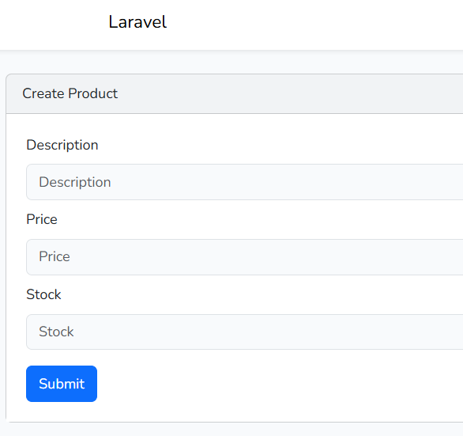
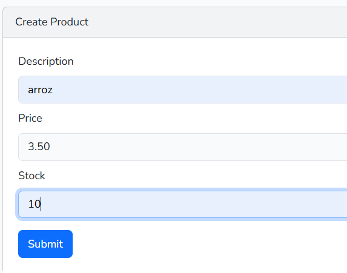
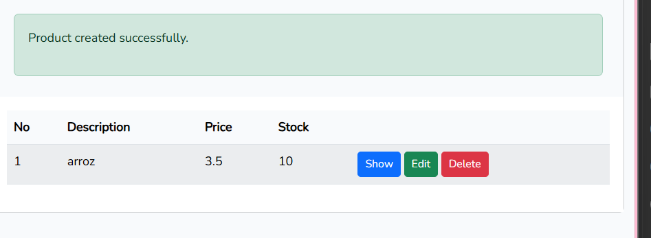
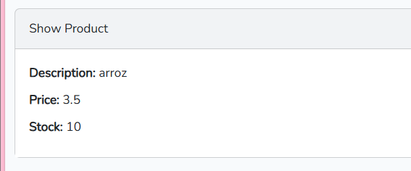
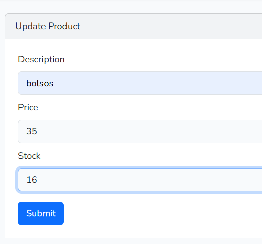
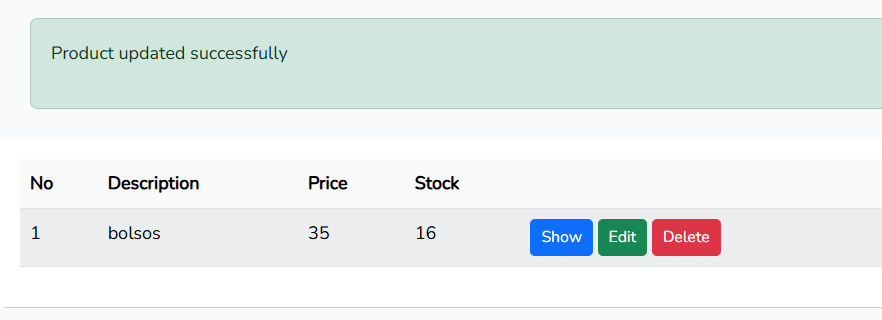
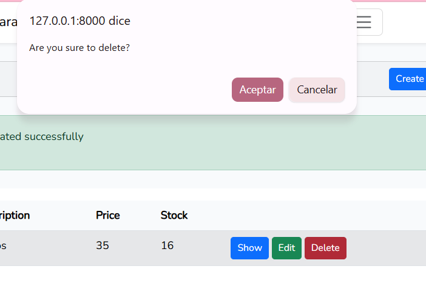
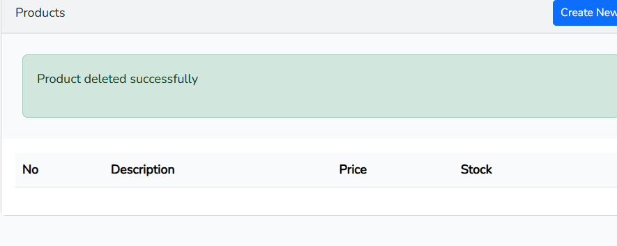

# Facultad de Sistemas Computacionales
## Licenciatura en Ciberseguridad

- **Estudiante:** Hanna Licona
- **Grupo:** 1S3122
- **Profesora:** Ing. Irina Fong

# CRUD Rápido de Productos

## Presentación

CRUD Rápido es una aplicación web desarrollada con Laravel para administrar un catálogo de productos. Permite crear, consultar, actualizar y eliminar registros, con formularios validados y una vista paginada del inventario.

## Requisitos

- PHP 8.3 o superior y Composer.
- Node.js y npm.
- SQLite y la extensión `pdo_sqlite` de PHP para usar la base de datos predeterminada.
- Git para clonar el repositorio.

## Recursos y funcionalidades

- Registro e inicio de sesión.
- Creación, consulta, edición y eliminación de productos.
- Listado paginado del inventario.
- Validación de los datos del producto:
  - **Descripción:** obligatoria, texto de hasta 255 caracteres.
  - **Precio:** obligatorio, numérico y mayor o igual a cero.
  - **Stock:** obligatorio, entero y mayor o igual a cero.
- Mensajes de confirmación al crear, actualizar o eliminar productos.

## Tecnologías utilizadas

- **PHP 8.4** — lenguaje de programación del servidor.
- **Laravel 13** — framework de la aplicación.
- **Laravel UI 4** — vistas de autenticación.
- **SQLite** — base de datos configurada por defecto.
- **Bootstrap 5** — componentes y estilos de interfaz.
- **Tailwind CSS 4** y **Vite 8** — herramientas de estilos y compilación del frontend.
- **Composer** y **npm** — administración de dependencias.

## Capturas

### Formulario para crear un producto



### Captura de los datos del producto



### Confirmación de creación



### Consulta de un producto



### Formulario para editar un producto



### Confirmación de actualización



### Confirmación antes de eliminar



### Confirmación de eliminación



## Instalación y ejecución

Clona el repositorio y accede a la carpeta del proyecto:

```bash
git clone https://github.com/hlemerix/crud_rapido_laravel.git
cd crud_rapido_laravel
```

Instala las dependencias, prepara el entorno, ejecuta las migraciones y compila los recursos del frontend:

```bash
composer run setup
```

Inicia el servidor local:

```bash
php artisan serve
```

Abre la dirección que indique Artisan, normalmente `http://127.0.0.1:8000`.

Para compilar los recursos del frontend automáticamente durante el desarrollo, ejecuta `npm run dev` en otra terminal.

La configuración inicial usa SQLite. Si cambias de motor de base de datos, actualiza las variables `DB_*` de `.env` y ejecuta:

```bash
php artisan migrate
```

No publiques el archivo `.env`, ya que puede contener credenciales y la clave de la aplicación. Usa `.env.example` como plantilla.

## Pruebas

Ejecuta las pruebas automatizadas con:

```bash
composer test
```

## Referencias

1. Laravel. [Documentación oficial](https://laravel.com/docs/13.x).
2. Laravel. [Guía de instalación](https://laravel.com/docs/13.x/installation).
3. Laravel. [Migraciones](https://laravel.com/docs/13.x/migrations).
4. Laravel UI. [Repositorio oficial](https://github.com/laravel/ui).
5. Composer. [Documentación](https://getcomposer.org/doc/).
6. Vite. [Guía oficial](https://vite.dev/guide/).
7. Bootstrap. [Documentación](https://getbootstrap.com/docs/5.3/).
8. Tailwind CSS. [Documentación](https://tailwindcss.com/docs).
9. SQLite. [Documentación oficial](https://www.sqlite.org/docs.html).

## Fecha de ejecución e información de la estudiante

El laboratorio se realizó el **22 de octubre de 2026**.

Este laboratorio fue desarrollado por:

- **Nombre:** Hanna Licona
- **Curso:** Desarrollo Web
- **Grupo:** 1S3122
- **Instructora:** Ing. Irina Fong
